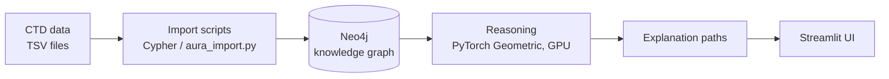

# Clinical Graph-Based Decision Support System

> Explainable clinical decision support over a biomedical knowledge graph, with GPU-accelerated reasoning.

> ⚠️ **Research prototype.** This system has not been clinically validated and must not be used for medical decisions or advice.

## Overview

An interactive, high-performance biomedical Clinical Decision Support (CDS) system leveraging heterogeneous Knowledge Graphs, PyTorch Geometric GPU acceleration, and traceable explainable AI (XAI) to assist clinicians in exploring complex multi-hop interactions between symptoms, diseases, genes, and therapeutic drugs.

## Features

- Explore diseases and related chemicals/drugs by traversing a knowledge graph built from CTD
- Every result comes with the **graph path** behind it, so the reasoning can be inspected
- GPU-accelerated reasoning with PyTorch Geometric
- Interactive Streamlit interface
- Fully containerized setup with Docker

## How it works



## Graph schema

| Node type | Description | Count |
|---|---|---|
| Disease | [..] | [..] |
| Chemical / Drug | [..] | [..] |
| Gene | [..] | [..] |

| Relationship | Connects | Meaning |
|---|---|---|
| [..] | [..] | [..] |

## Results

| Metric | Value |
|---|---|
| [e.g. top-k accuracy / path quality / query latency] | [..] |
| [GPU vs CPU speed-up] | [..] |

## Tech stack

Python · Neo4j · PyTorch Geometric · Streamlit · Docker · NVIDIA CUDA · WSL2 (Ubuntu 22.04) RAPIDS/cuGraph

## Getting started

### Prerequisites
- Docker and Docker Compose
- NVIDIA GPU with CUDA [version] for GPU reasoning (CPU fallback: no)
- Neo4j Aura account or local Neo4j

### Run with Docker
```bash
git clone https://github.com/olive-s-11/clinical-graph-cds.git
cd clinical-graph-cds
cp .env.example .env        # add your Neo4j credentials
docker compose up --build
```
Then open http://localhost:8501

### Load the data
```bash
python scripts/aura_import.py
```

## Data

Source: [Comparative Toxicogenomics Database (CTD)](https://ctdbase.org/) (full dataset ~9 GB, not included because of GitHub size limits). A 50k-row sample is in `data/sample/` for reproducibility and demos. To use the full data, download it from CTD. Please cite CTD as described on their site.

## Limitations

- Built on CTD curation, so coverage and bias follow that source
- Not validated with clinicians
