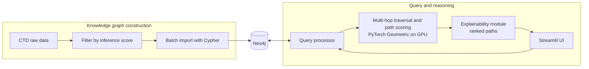

# Clinical Graph-Based Decision Support System

> Explainable clinical decision support over a biomedical knowledge graph built from CTD, with GPU-accelerated multi-hop reasoning and an interactive Streamlit interface.

> ⚠️ **Research prototype.** This system has not been clinically validated and must not be used for medical decisions or advice.

## Overview

Clinicians have to weigh genes, diseases and drugs together, but black-box models give no reasoning to inspect, and large biomedical graphs are slow to traverse. This project builds a knowledge graph from the [Comparative Toxicogenomics Database (CTD)](https://ctdbase.org/) in Neo4j, ranks multi-hop paths with a weighted scoring function on the GPU (PyTorch Geometric), and shows every result together with the graph path that produced it.

## Highlights

- **Knowledge graph from CTD:** gene–disease associations filtered by inference score and loaded into Neo4j in batches
- **Explainable results:** each ranked disease comes with its reasoning path and supporting evidence
- **GPU-accelerated reasoning:** about 8–9× faster path traversal than CPU-only execution
- **Interactive exploration:** Streamlit app with ranked tables and visual subgraphs
- **Reproducible setup:** Docker, NVIDIA runtime, and WSL2 development environment

## How it works



**Pipeline**

1. **Preprocess:** drop comment lines, extract gene and disease fields, keep associations with inference score ≥ 4.0
2. **Build the graph:** create uniqueness constraints, then import in batches with periodic commits
3. **Reason:** multi-hop traversal from the queried entity, path scoring, and rank aggregation on GPU
4. **Explain:** return the highest-scoring paths with their evidence for inspection in the UI

**Path scoring**

$$\text{Score}(P) = \sum_{i=1}^{n} w_i \cdot r_i$$

where $n$ is the number of relationships in the path, $r_i$ is the confidence score of the $i$-th relationship, and $w_i$ is the weight for its relationship type.

## Graph schema

| Element | Details |
|---|---|
| `Gene` node | unique `gene_id`, gene symbol |
| `Disease` node | unique `disease_id` (MeSH), disease name |
| `ASSOCIATED_WITH` | `Gene → Disease`, carrying inference score, evidence type, chemical inference, and PubMed ID |

Graph loaded in Neo4j: **[N] nodes, [M] relationships** (from the filtered CTD gene–disease file).

## Results

Measured on an Intel i7-12700K, 32 GB RAM, NVIDIA GPU [model], Neo4j 5.11, Windows with WSL2 (Ubuntu).

**Traversal time**

| Query size | CPU (s) | GPU (s) | Speed-up |
|---|---|---|---|
| Small (1–5 nodes) | 2.5 | 0.3 | 8.3× |
| Medium (5–20 nodes) | 12.7 | 1.5 | 8.5× |
| Large (20–50 nodes) | 48.9 | 5.2 | 9.4× |

**Path ranking accuracy** (share of top-ranked paths that match known CTD associations)

| Top-k | Accuracy |
|---|---|
| Top 3 | 91.2% |
| Top 5 | 88.7% |
| Top 10 | 84.5% |

> Accuracy is measured against CTD, which is also the source of the graph, so it shows consistency with the data rather than clinical validity.

## Tech stack

Python · Neo4j · PyTorch Geometric · Streamlit · Docker (NVIDIA runtime) · CUDA · WSL2 (Ubuntu)

## Getting started

### Prerequisites
- NVIDIA GPU with current drivers
- Docker with the NVIDIA Container Toolkit (on Windows: WSL2 with Ubuntu)
- Neo4j 5.x (included in the Docker setup) or a Neo4j Aura instance

### Run
```bash
git clone https://github.com/olive-s-11/clinical-graph-cds.git
cd clinical-graph-cds
cp .env.example .env          # Neo4j connection settings
docker compose up --build
```
Then open http://localhost:8501 (Streamlit's default port).

### Load the graph
Run the Cypher files in `neo4j/cypher/` in order: `constraints.cypher`, then `import_batched.cypher` (sample data) or `import_full.cypher` (full CTD). To load into Neo4j Aura instead, use `aura_import.py`.

### Try it
Enter a gene ID, for example `100174880`, and click **Search** to see ranked disease associations and the graph around them.

## Data

- **Source:** CTD gene–disease associations ([ctdbase.org/downloads](https://ctdbase.org/downloads/))
- **Preprocessing result:** 122,721,284 raw rows → 109,560,842 rows kept after filtering (about 9.8 GB), so the full file is **not included** in this repo
- **Sample:** a 50k-row sample ships in `data/` for demos and reproducibility

## Limitations

- Research prototype with no clinical validation or clinician evaluation yet
- CTD coverage and curation bias carry through to the results

## Future work

- Integrate additional biomedical datasets
- Run a clinician-rated evaluation of the explanations

## Data

A. Davis et al., "Comparative Toxicogenomics Database (CTD): update 2019," *Nucleic Acids Research*, 47(D1):D948–D954, 2019.
